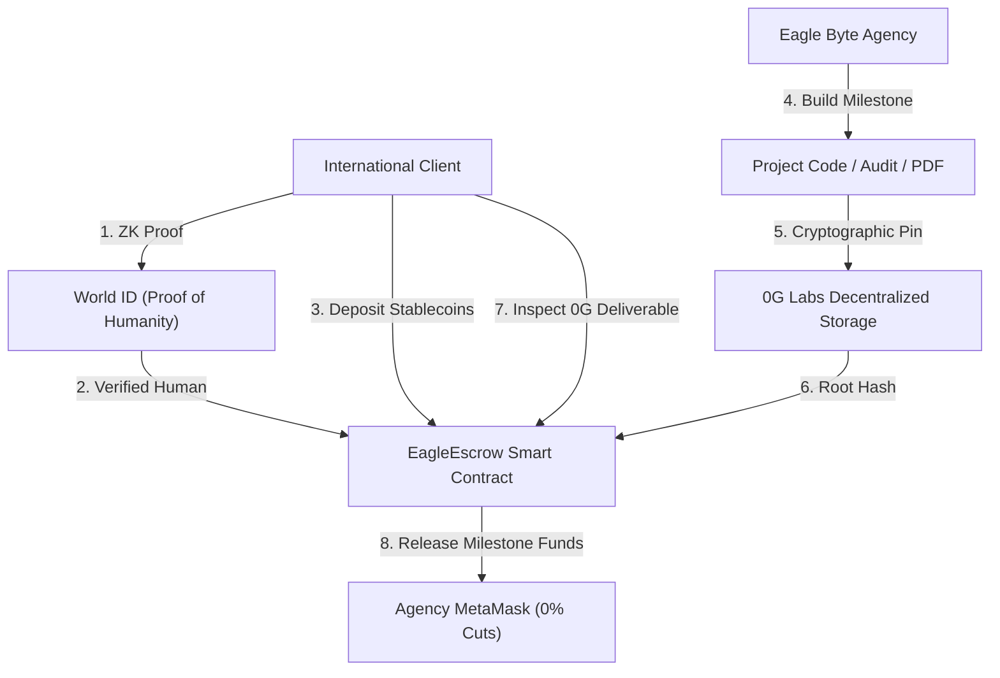

# 🦅 EagleEscrow Protocol — ETHGlobal Submission Kit

> **The First AI-Verifiable, Sybil-Resistant International Service Escrow Protocol**
> Powered by **World ID**, **0G Decentralized Storage**, **ENS**, and **EVM Multi-Chain Settlement**.

---

## 🎯 1. Project Overview

- **Project Name**: EagleEscrow Protocol
- **Track**: DeFi / Web3 Infrastructure & Real-World Services
- **Target Bounties**:
  - 🏆 **Best Use of World ID** (Proof of Humanity / Sybil-Resistance)
  - 🏆 **Best Use of 0G Labs** (Decentralized Storage & Verifiable Deliverables)
  - 🏆 **Best Use of ENS** (Decentralized Invoicing & Subdomain Identities)
  - 🏆 **Best Multi-Chain Payment / Escrow Architecture**

---

## 💡 2. The Problem ($50B Cross-Border Dilemma)

International freelancers and dev agencies face severe friction:
1. **The Trust Deficit**: Clients fear upfront payments without deliverables. Agencies fear working without guaranteed pay.
2. **Platform Exploitation**: Upwork and Fiverr charge **10%–20% commission fees**.
3. **Banking Inefficiencies**: PayPal, Stripe, and SWIFT drain **4%–6% in international transfer and forex spreads**, taking 3–5 business days to clear.
4. **Sybil & Bot Fraud**: Disreputable actors create throwaway accounts to dispute completed work, commit chargebacks, or submit malicious review bombs.

---

## ⚡ 3. The Solution: EagleEscrow

EagleEscrow is a decentralized milestone escrow protocol tailored for international B2B services:



1. **World ID Sybil Protection**: Clients verify their uniqueness with World ID ZK-proofs before deploying high-value escrow agreements. No bots, no synthetic scam accounts.
2. **0G Labs Verifiable Storage**: Milestone deliverables (zip files, code commits, audit PDFs) are pinned directly to **0G Decentralized Storage**, creating an immutable proof-of-delivery root hash.
3. **Decentralized Escrow Smart Contract**: Funds (USDC, USDT, ETH, POL) are locked on-chain in [`EagleEscrow.sol`](file:///c:/ethglobal/Eagle-Byte-main/Eagle-Byte-main/contracts/EagleEscrow.sol).
4. **ENS Invoice Subdomains**: Human-readable identities like `inv-904.eaglebyte.eth` mapped to on-chain contract agreements.
5. **Instant Sub-Cent Settlement**: Operates across Arbitrum, Polygon, and Base with **< $0.01 gas fees**, saving 4–6% compared to traditional banking.

---

## 🛠️ 4. Technical Stack

- **Smart Contract**: Solidity `^0.8.24` ([`contracts/EagleEscrow.sol`](file:///c:/ethglobal/Eagle-Byte-main/Eagle-Byte-main/contracts/EagleEscrow.sol)) with ReentrancyGuard, World ID ZK verification, and 0G deliverable storage hooks.
- **Identity & Sybil Verification**: `@worldcoin/idkit` / World ID Proof of Humanity.
- **Decentralized Storage**: 0G Labs Storage Gateway (`storage-indexer-testnet.0g.ai`) for verifiable deliverable hashing.
- **Frontend**: React 18, Vite, Tailwind CSS, Framer Motion, TypeScript.
- **Web3 Wallet Rails**: `@rainbow-me/rainbowkit`, `wagmi`, `viem` supporting MetaMask, Coinbase Wallet, Trust Wallet, Phantom, and WalletConnect.

---

## 🚀 5. Quick Start & Demo Verification

### Running the Live App:
```bash
cd Client
npm install
npm run dev
```

- **Escrow Protocol Dashboard**: [http://localhost:8080/escrow](http://localhost:8080/escrow)
- **Direct Pay Portal**: [http://localhost:8080/pay](http://localhost:8080/pay)
- **Agency Website**: [http://localhost:8080/](http://localhost:8080/)

---

## 🎥 6. ETHGlobal 2-Minute Demo Video Script

**0:00 – 0:30 (The Hook & Problem)**:
> *"Hello judges! As international developers, getting paid across borders is broken. Centralized platforms take 20% cuts, banks cut 5% in FX fees, and clients worry about getting scammed. Today, we present EagleEscrow: the first AI-verifiable, Sybil-resistant milestone escrow protocol."*

**0:30 – 1:00 (World ID & Escrow Deployment)**:
> *"Notice our Create Escrow portal. Before any client can lock funds, they verify their human uniqueness with World ID ZK-proofs. This completely eliminates synthetic identity fraud. The client sets milestones, specifies the ENS agreement, and locks USDC into our deployed smart contract."*

**1:00 – 1:30 (0G Storage Deliverables & Milestone Release)**:
> *"When Milestone 1 is finished, the service provider uploads the project deliverable directly to 0G Labs Decentralized Storage. An immutable root hash is submitted to the blockchain. The client inspects the 0G storage proof, clicks 'Approve & Release', and funds instantly land in the provider's MetaMask wallet with sub-cent gas fees."*

**1:30 – 2:00 (Vision & Future)**:
> *"By combining World ID, 0G Storage, ENS, and low-cost EVM settlement, EagleEscrow eliminates 20% platform fees and brings trustless, friction-free commerce to global digital services. Thank you!"*
